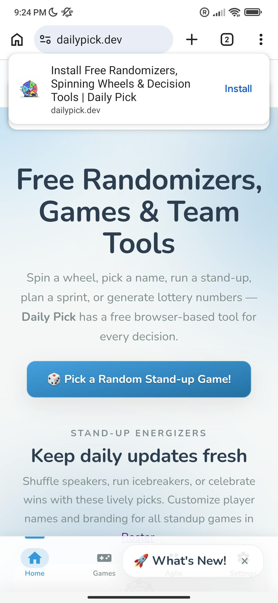
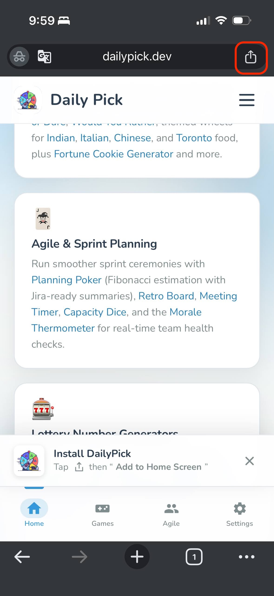
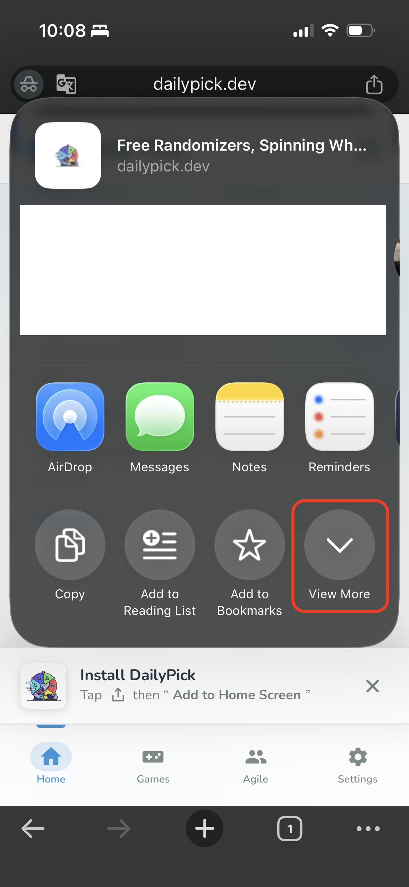
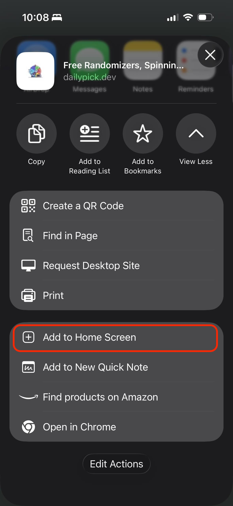

We're excited to announce that Daily Pick now supports Progressive Web App (PWA) functionality! This means you can install Daily Pick directly on your mobile device, just like a native app, for a seamless experience on both Android and iOS.

---

**Table of Contents**
- [What is a Progressive Web App?](#what-is-a-progressive-web-app)
- [Benefits of Installing Daily Pick as a PWA](#benefits-of-installing-daily-pick-as-a-pwa)
- [How to Install on Android](#how-to-install-on-android)
- [How to Install on iOS](#how-to-install-on-ios)
- [Using Daily Pick Offline](#using-daily-pick-offline)
- [Troubleshooting](#troubleshooting)
- [What's Next](#whats-next)
- [Frequently Asked Questions](#frequently-asked-questions)

## What is a Progressive Web App?

A Progressive Web App combines the best of web and mobile apps. You access it through your browser, but it can be installed on your home screen, work offline, and provide a native app-like experience.

---

## Benefits of Installing Daily Pick as a PWA

- **Offline Access**: Spin the [Decision Wheel](/apps/wheel/), roll with [Coin Flip & Dice](/apps/coin-flip-dice-roller/), or run [Speedway Racer](/apps/speedway/) even without an internet connection
- **Native Feel**: App-like interface with home screen icon and zero browser address bar clutter
- **No App Store Required**: Install directly from the website with zero downloads from Google Play or Apple App Store
- **Automatic Updates**: Always get the latest features without manual app store updates
- **Cross-Platform**: Works smoothly across Android, iOS, iPadOS, Mac, and Windows desktop

---

## How to Install on Android

1. Open Daily Pick in your Chrome browser
2. Tap the menu button (three dots) in the top right
3. Select "Add to Home screen"
4. Confirm the installation

---

## How to Install on iOS

1. Open Daily Pick in Safari
2. Tap the **Share** button in the top right of the address bar
3. In the share sheet, tap **View More**
4. Tap **Add to Home Screen** and confirm

  <figure style="margin:0;text-align:center">
    
    <figcaption style="font-size:0.8rem;color:#7f8c8d;margin-top:0.4rem">Step 1 — Tap Share</figcaption>
  </figure>
  <figure style="margin:0;text-align:center">
    
    <figcaption style="font-size:0.8rem;color:#7f8c8d;margin-top:0.4rem">Step 2 — Tap View More</figcaption>
  </figure>
  <figure style="margin:0;text-align:center">
    
    <figcaption style="font-size:0.8rem;color:#7f8c8d;margin-top:0.4rem">Step 3 — Tap Add to Home Screen</figcaption>
  </figure>

---

## Using Daily Pick Offline

Once installed, Daily Pick will work offline for almost every standalone tool. While real-time multiplayer rooms require an active internet connection, all your favorite randomizers—including the [Random Picker Wheel](/apps/wheel/), [Random Number Generator](/apps/random-number-generator/), and [Giveaway Winner Picker](/apps/giveaway-winner-picker/)—are cached locally for lightning-fast launch anytime, anywhere.

---

## Troubleshooting

If you encounter issues installing the PWA:

- Ensure you're using a supported browser (Chrome for Android, Safari for iOS)
- Check that your device has enough storage space
- Try clearing your browser cache and retrying

---

## What's Next

We're continuously improving the PWA experience. Future updates will include push notifications for team activities and enhanced offline capabilities.

Have questions or feedback? [Contact us](https://dailypick.dev/feedback/) or join the conversation on our [feedback page](https://dailypick.dev/feedback/).

---

*Daily Pick - Making team decisions fun, fair, and fast.*

## Frequently Asked Questions

**Q: Does installing the Daily Pick PWA require space from my app store quota?**  
A: No. Progressive Web Apps (PWAs) take up only a few megabytes of cached browser storage and install instantly without going through Google Play or Apple App Store downloads.

**Q: Do Daily Pick tools work offline once installed?**  
A: Yes. Essential tools—including the Decision Wheel, Random Number Generator, and Timers—are cached via the service worker and function seamlessly even without an active internet connection.

**Q: How do I update the Daily Pick app once installed?**  
A: PWAs update automatically in the background whenever you open the app with an internet connection, ensuring you always have the latest games and features.
